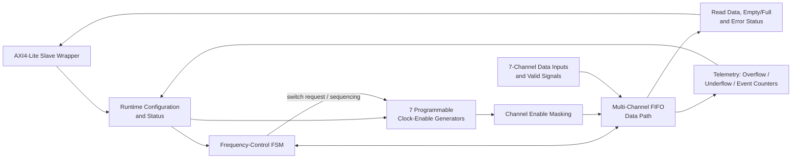

# Runtime Clock Control and Multi-Channel FIFO on FPGA

An FPGA-based runtime clock-control design with seven configurable frequency channels, multi-channel FIFO buffering, and an AXI4-Lite control interface. The design uses an FSM to coordinate frequency changes and includes status telemetry for monitoring errors.

## Features

- **Seven configurable frequency channels** using programmable clock-enable generation.
- **Multi-channel FIFO buffering** for channel data management.
- **FSM-based frequency switching** with FIFO-drain coordination and watchdog timeout handling.
- **AXI4-Lite slave interface** for runtime configuration and status monitoring.
- **Error telemetry** with sticky overflow/underflow indicators and clock-event counters.
- **Single-system-clock architecture:** the reported final design uses clock-enable pulses and synchronous FIFO logic rather than relying on multiple generated clocks.

## Architecture Overview

1. **Clock-enable generation** — programmable divisors generate enable pulses for the seven channels.
2. **Channel data buffering** — FIFO logic buffers data from the channels and exposes data/status signals.
3. **Frequency-control FSM** — coordinates a requested change, waits for FIFO draining, applies the new configuration, and resumes operation. Watchdog/error handling covers abnormal waits.
4. **AXI4-Lite control** — software or a bus master can configure the block and read status information.
5. **Telemetry** — status signals record events such as overflow and underflow for later inspection.

## Block Diagram

The following Mermaid diagram summarizes the system at a high level. It is a conceptual view based on the modules and architecture described in the project report; verify the exact signal-level connections against the final Vivado top module.

**Main data/control flow:** AXI4-Lite provides configuration and status access. The FSM coordinates safe frequency changes, the programmable generators produce per-channel clock-enable pulses, and the enable logic controls channel activity. FIFO status and telemetry provide visibility into data-path conditions.

## Technology Stack

- Verilog HDL
- Xilinx Vivado
- AXI4-Lite
- Finite State Machine (FSM) design
- Clock-enable generation
- FIFO design and control
- Xilinx FPGA implementation and timing analysis

## Reported Implementation Results

The project report compares an initial implementation with a refactored implementation:

| Metric | Initial | Refactored | Reported change |
|---|---:|---:|---:|
| LUT utilization (count) | 3,062 | 2,052 | 33.0% lower |
| Flip-flop utilization (count) | 3,570 | 2,395 | 32.9% lower |
| BUFG utilization (count) | 9 | 1 | 88.9% lower |
| LUTRAM utilization (count) | 203 | 203 | No change |
| WNS | 5.239 ns | 4.15 ns | Both reported as positive |
| TNS | 0 ns | 0 ns | No negative slack reported |
| Total on-chip power | 3.355 W | 3.346 W | 0.009 W lower |
| Junction temperature | 28.3 °C | 28.3 °C | No change |

**Important:** These values are taken from the project report and have not been independently reproduced here. Check the Vivado reports and target-device details before presenting them as verified results. WNS is lower in the refactored implementation, although the report lists TNS as 0 ns for both.

## Source Files

The submitted archive contains these files:

| File | Purpose (based on the source/report naming) |
|---|---|
| `clk_control_core1.v` | Clock-control core and top-level integration of control/data-path blocks |
| `freq1.v` | Programmable clock-enable generation |
| `fsm1.v` | Frequency-control FSM, including timeout/error handling |
| `clk_gate_unit.v` | Channel/global enable masking logic |
| `week.v` | Top-level multi-channel FIFO/data-path logic |
| `async1.v` | Asynchronous FIFO implementation; verify whether this is legacy or used in the final single-clock architecture |
| `test_wrapper1.v` | AXI4-Lite slave wrapper |
| `clk_control_core_tb1.v` | Testbench for the clock-control core |
| `constraints.xdc` | Vivado timing and/or I/O constraints |

File names and roles should be checked against the final top module and actual Vivado project configuration.

## Verification

The report lists implementation and timing metrics for the initial and refactored designs. Before reproducing or extending the results, verify the project using the intended Vivado version and FPGA part.

Suggested checks:

- Run RTL simulation with the provided testbench.
- Test reset behavior and normal channel data flow.
- Request a frequency change while FIFOs contain data and verify the drain/switch/resume sequence.
- Exercise watchdog timeout and FSM error handling.
- Check overflow/underflow telemetry and clock-event counters.
- Run synthesis, implementation, timing analysis, and utilization/power reports in Vivado.
- Confirm the final design uses the intended synchronous FIFO architecture and identify whether `async1.v` is unused legacy code.

## How to Use

1. Open the project in Xilinx Vivado.
2. Add the RTL source files and `constraints.xdc` to the project.
3. Select the correct FPGA part/board and set the intended top module.
4. Add `clk_control_core_tb1.v` as a simulation source and configure the testbench top.
5. Run behavioral simulation, then synthesis and implementation.
6. Review timing, utilization, and any design-rule warnings before treating the reported results as verified.

Exact clock settings, FPGA part number, AXI address mapping, and build commands are not included here because they should be taken from the project’s Vivado configuration and constraints.

## Project Goals

- Support runtime configuration across seven frequency channels.
- Coordinate frequency changes through an FSM.
- Buffer channel data and expose status through an AXI4-Lite interface.
- Reduce clock-buffer and logic utilization through a single-clock, clock-enable-based implementation.

## Author

Add your name, institution, and project date here.
